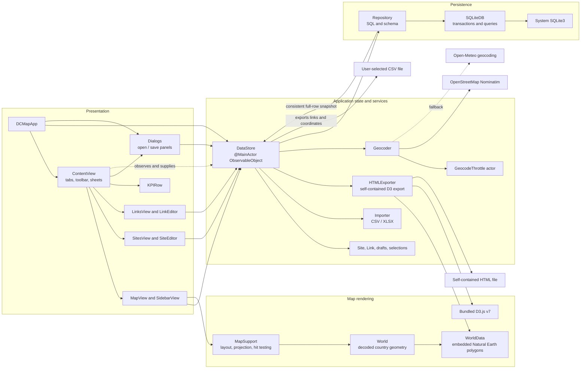
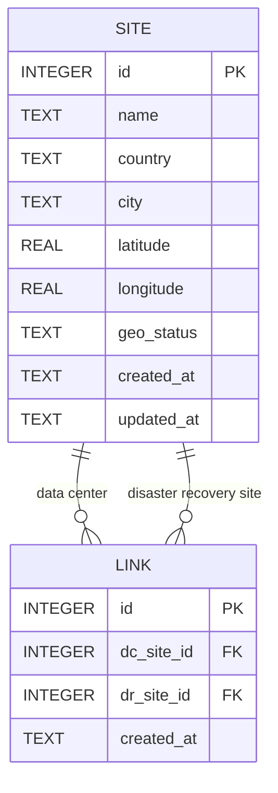
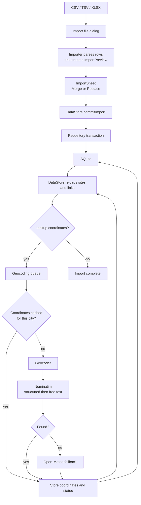
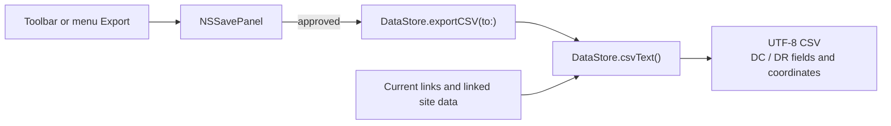
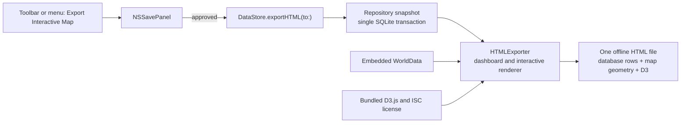

# DCMap Architecture

DCMap is a native macOS SwiftUI application. The executable is built with Swift Package Manager, stores site and replication-link data in local SQLite, and uses the system frameworks for its UI, networking, and file dialogs.

## Component overview

[`DataStore`](./Sources/DCMap/Store.swift) is the UI's single source of truth. It owns the repository, publishes sites, links, selection, progress, and alerts, and performs mutations on the main actor. Views read this state and call store operations; successful database changes are reflected in the UI by reloading the stored data.

[`MapView`](./Sources/DCMap/MapView.swift) combines site/link state from `DataStore` with [`MapSupport`](./Sources/DCMap/MapSupport.swift) for coordinate projection, link geometry, and hit testing. The native map animates replication packets and site pulses, and supports role filters, selection focus, and zoom/pan. [`World`](./Sources/DCMap/World.swift) decodes the embedded country polygons in [`WorldData`](./Sources/DCMap/WorldData.swift) once, and the map renders them offline. The [`StateCompat`](./Sources/DCMap/StateCompat.swift) property wrapper supplies SwiftUI-managed state without requiring the unavailable `SwiftUIMacros.StateMacro` plugin.

## Persistence model

The database is `~/Library/Application Support/DCMap/dcmap.sqlite`. SQLite runs in WAL mode with foreign keys enabled. Site names and cities are unique together, case-insensitively; link endpoint pairs are unique, and deleting a site cascades to its links. A self-link is valid and represents a site protecting itself. Site role flags shown in the UI are derived from the links rather than stored separately.

## Import and geocoding flows

The importer reads delimited text directly and reads `.xlsx` worksheet XML using the macOS `unzip` utility. It builds a preview before any database changes; the user chooses whether to merge or replace. Import writes are transactional, and coordinate lookup after import is optional.

The geocoding service throttles Nominatim requests, then falls back to Open-Meteo if needed. The store caches results by normalized city and country during a queue run, updates each site's coordinate status, and stops after three consecutive network failures. Manually entered coordinates are not overwritten by bulk lookup.

### CSV export

Export uses the current in-memory state, includes each link with its data-center and DR site details, and writes coordinates when available. The file is written atomically to the location selected in the save panel.

### Interactive HTML map export

The snapshot contains every site and link row, including IDs, coordinate status, and database timestamps. The HTML presents KPI tiles, the map, and a searchable sidebar; D3 draws the Natural Earth geometry, highlighted countries, quadratic replication routes, role-colored sites, and selection labels. Its controls provide animated route dashes and packet tails, pulsing site markers, moving self-DR rings, role filters, selection dimming/focus, and zoom/pan. The HTML embeds the data and geometry as JSON, plus the D3 browser bundle and its license, so it makes no network requests. SheetJS is omitted because this export reads SQLite directly and has no spreadsheet input.

## Source map

| Area | Files |
|---|---|
| App entry and navigation | [DCMapApp.swift](./Sources/DCMap/DCMapApp.swift), [ContentView.swift](./Sources/DCMap/ContentView.swift) |
| Published state and domain models | [Store.swift](./Sources/DCMap/Store.swift), [Models.swift](./Sources/DCMap/Models.swift), [StateCompat.swift](./Sources/DCMap/StateCompat.swift) |
| Persistence | [Repository.swift](./Sources/DCMap/Repository.swift), [SQLiteDB.swift](./Sources/DCMap/SQLiteDB.swift) |
| Map and geometry | [MapView.swift](./Sources/DCMap/MapView.swift), [MapSupport.swift](./Sources/DCMap/MapSupport.swift), [World.swift](./Sources/DCMap/World.swift), [WorldData.swift](./Sources/DCMap/WorldData.swift) |
| Import, export, and geocoding | [Importer.swift](./Sources/DCMap/Importer.swift), [HTMLExporter.swift](./Sources/DCMap/HTMLExporter.swift), [Geocoder.swift](./Sources/DCMap/Geocoder.swift) |
| HTML export resources | [d3.v7.min.js](./Sources/DCMap/Resources/d3.v7.min.js), [D3-LICENSE.txt](./Sources/DCMap/Resources/D3-LICENSE.txt) |
| App packaging and icon | [Package.swift](./Package.swift), [build_app.sh](./build_app.sh), [generate_app_icon.swift](./Scripts/generate_app_icon.swift) |

## Build and app bundle

[`Package.swift`](./Package.swift) defines one macOS 14+ executable target, bundles D3 for HTML export, and links the system `sqlite3` library. `swift run -c release` runs the executable directly. [`build_app.sh`](./build_app.sh) builds a release binary and assembles `build/DCMap.app`; it copies the SwiftPM resource bundle, generates the icon from the embedded world polygons using [`generate_app_icon.swift`](./Scripts/generate_app_icon.swift), writes the bundle metadata, and ad-hoc signs the app.
